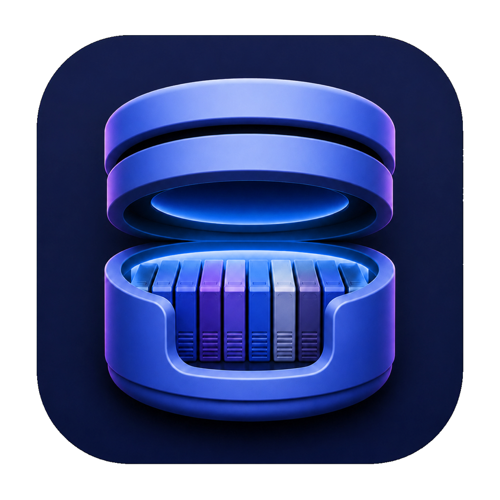
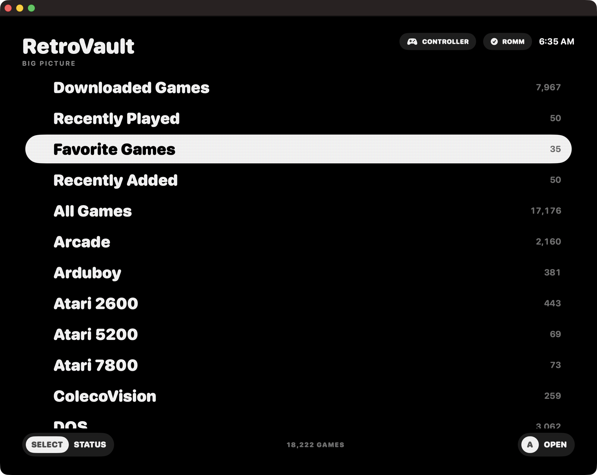

<p align="center">
  
</p>

<h1 align="center">RetroVault</h1>

<p align="center">
  <strong>A native macOS library and player for RomM.</strong>
</p>

<p align="center">
  <a href="MILESTONES/README.md"></a>
  
  
  
  <a href="LICENSE"></a>
</p>

RetroVault connects a Mac to a single [RomM](https://romm.app) server and turns
its catalog into a fast, controller-first game library. It synchronizes
metadata for offline browsing, manages local downloads for offline play, and
launches supported titles without reorganizing or duplicating the server's
library. RomM is developed by the
[RomM Project](https://github.com/rommapp/romm).

RomM remains the source of truth. RetroVault adds native macOS presentation,
Metal video, controller navigation, managed firmware, save synchronization,
and emulation through bundled Libretro cores plus hosted Cemu, Vita3K, and
Ryubing engines.



> [!IMPORTANT]
> RetroVault is under active development. It requires macOS 15 (Sequoia) or
> later on Apple silicon and targets the RomM 5.x API. macOS 26 draws custom
> controls with Liquid Glass; macOS 15 uses a standard material. Compatibility
> and save handling still vary by system and title.

## Install

Download the Apple-silicon DMG from
[GitHub Releases](https://github.com/kennethreitz/RetroVault/releases), open it,
and drag RetroVault to Applications.

Preview releases are signed ad hoc rather than with an Apple Developer ID and
are not notarized. On first launch, macOS will block the app. After attempting
to open it, go to **System Settings → Privacy & Security**, scroll to
**Security**, choose **Open Anyway**, and confirm **Open**. Only make this
exception for a DMG downloaded from the official release page; each release
also publishes a SHA-256 checksum.

## Highlights

- Controller-first browsing for downloaded games, recent games, favorites,
  the complete catalog, and individual systems.
- Offline metadata and artwork cache with managed game downloads.
- Download, export, firmware, save, and save-state workflows that keep RomM as
  the authoritative library.
- Metal rendering with native, LCD, and CRT presentation modes.
- Windowed and fullscreen play, Game Mode, rewind, fast-forward, quick resume,
  and multi-controller support where the engine allows them.
- Native macOS controllers and DSU/Cemuhook input, including the Switch 2 Pro
  Controller through
  [switch2bridge-macos](https://github.com/kennethreitz/switch2bridge-macos).
- A controller-friendly Save Center for local, remote, pending, and failed
  save synchronization.
- RetroAchievements sets and unlock progress that RomM already stores, shown
  in Get Info and the library when a ROM is matched and the RomM user has a
  RetroAchievements username.

## Emulation

RetroVault bundles Apple-silicon Libretro cores and manages their video, audio,
input, firmware, and save paths. Cemu, Vita3K, and Ryubing are hosted standalone
engines. RetroVault prepares their private installations and integrates them
with the same library, controller, and save workflows.

| Systems | Engine | Integration |
| --- | --- | --- |
| Game Boy, Game Boy Color | Gambatte | Libretro |
| Game Boy Advance | mGBA | Libretro |
| NES | Nestopia UE | Libretro |
| SNES | bsnes-mercury Balanced | Libretro |
| Nintendo 64 | ParaLLEl-N64 | Libretro |
| Nintendo DS | melonDS | Libretro |
| GameCube, Wii | Dolphin | Libretro |
| Wii U | Cemu | Hosted, experimental; Metal or Vulkan |
| Nintendo Switch | Ryubing (Ryujinx) | Hosted, experimental; Vulkan via MoltenVK |
| Master System, Game Gear, SG-1000 | Gearsystem | Libretro |
| Genesis / Mega Drive, Sega CD / Mega CD | Genesis Plus GX | Libretro |
| Sega 32X | PicoDrive | Libretro |
| Dreamcast | Flycast | Libretro, experimental |
| PlayStation | PCSX-ReARMed | Libretro |
| PlayStation Portable | PPSSPP | Libretro |
| PlayStation Vita | Vita3K | Hosted, experimental |
| PC Engine / TurboGrafx-16, SuperGrafx, PC Engine CD | Beetle PCE | Libretro |
| Atari 2600, 5200, 7800 | Stella 2014, A5200, ProSystem | Libretro |
| ColecoVision | Gearcoleco | Libretro |
| Neo Geo Pocket / Color | Beetle NeoPop | Libretro |
| WonderSwan / Color | Beetle Cygne | Libretro |
| Arcade | FinalBurn Neo | Libretro |
| DOS | DOSBox Pure | Libretro |
| Virtual Boy | Beetle VB | Libretro |
| Pokemon Mini | PokeMini | Libretro |
| Arduboy | Arduous | Libretro |
| Pico-8 | FAKE-08 | Libretro |

Exact core revisions, licenses, hashes, and build requirements are recorded in
[`Libretro/CoreManifest.json`](Libretro/CoreManifest.json). RetroVault does not
bundle games, firmware, BIOS files, or cryptographic keys.

Switch support uses an optional external Ryubing install. See
[`docs/switch-setup.md`](docs/switch-setup.md) for setup.

Do not re-sign the embedded `Ryujinx.app`; its original ad-hoc signature must
stay intact. The build copies it untouched and signs only the outer app.

## RetroAchievements

When the RomM server has a RetroAchievements API key, Get Info shows the
achievement set RomM stored for a matched ROM, including a link to the game
on RetroAchievements. If that RomM user also has a RetroAchievements username,
Get Info, the library, and Big Picture show the unlock progress from RomM's
last sync. A ROM with no match stays blank. Unlocks stay hidden until a
username is set on the RomM profile and a sync has run.

Settings can also sign in to RetroAchievements directly. The password is used
once to obtain a session token, and only that token is kept in the Keychain.
While a supported game is running, RetroVault uses rcheevos to hash the ROM,
read core memory, and submit softcore unlocks. Hardcore mode is a separate
switch that is off until you turn it on. RetroAchievements does not accept
hardcore credit until it verifies RetroVault.

## Preservation

RetroVault is built for personal game archives whose historical value extends
beyond the game files themselves. Metadata, regional releases, artwork,
firmware relationships, and player saves all help preserve software whose
original media, hardware, storefronts, and online services will not remain
available forever.

Support therefore focuses on systems with maintainable Apple-silicon emulation
and dependable save handling. RomM can still catalog unsupported platforms;
RetroVault preserves and presents that catalog without claiming every title is
playable.

## Build

Requirements: an Apple-silicon Mac running macOS 15 or later, and Xcode 26
or later. The build uses the macOS 26 SDK so Liquid Glass can be compiled
behind an availability check. Xcode 26.0 through 26.3 run on macOS Sequoia
15.6 or later; the built app still launches on macOS 15.0.

Rebuild bundled Libretro cores, the experimental Vita3K engine, and the Cemu
Metal companion after this deployment-target change. Those build scripts pin
`-mmacosx-version-min=15.0` / `CMAKE_OSX_DEPLOYMENT_TARGET=15.0`. Binaries
produced with the previous 26.0 minimum will not load on macOS 15. The
official Cemu companion fetched by `Scripts/fetch-cemu-companion.sh` is
already a macOS 12 build.

```shell
open RetroVault.xcodeproj
```

Command-line builds and tests:

```shell
swift build
swift test
Scripts/fetch-ryujinx-companion.sh   # optional; enables Switch
Scripts/build-app.sh
```

The Ryubing build phase embeds `Build/RyujinxCompanion/Ryujinx.app` when it is
present. Switch support is skipped in builds without it.

Project history is recorded in [`CHANGELOG.md`](CHANGELOG.md), and core build
details live in [`Libretro/README.md`](Libretro/README.md).

RetroVault uses Calendar Versioning in `YYYY.M.D` form. The bundle build number
uses the same date as `YYYYMMDD`.

## License

RetroVault original code is licensed under the GNU General Public License,
version 2 or later, with the narrowly scoped RetroVault Core Linking
Exception. Bundled cores and hosted emulators retain their own licenses; some
components prohibit commercial use. See [LICENSE](LICENSE) and
[THIRD_PARTY_NOTICES.md](THIRD_PARTY_NOTICES.md).
